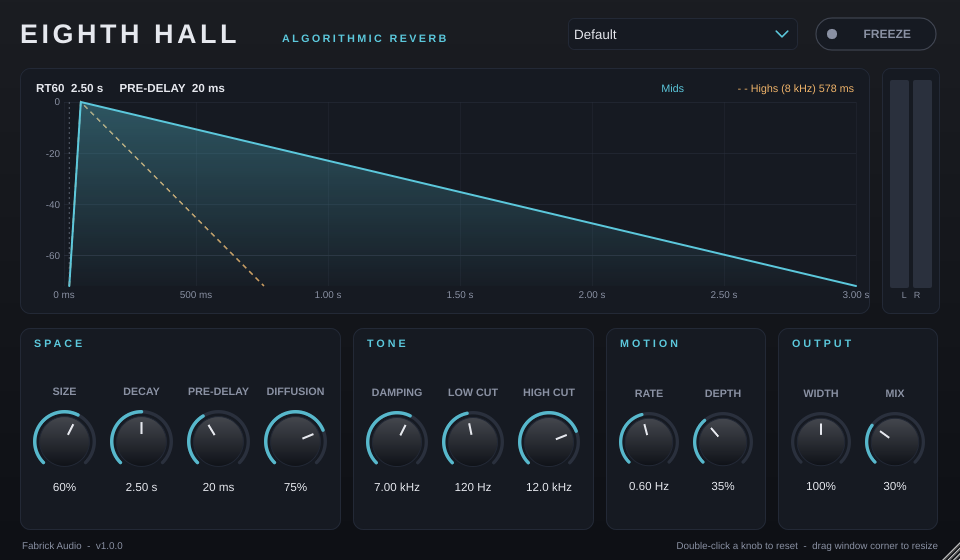

# Eighth Hall - Algorithmic Reverb

**A stereo algorithmic reverb plugin (VST3 / AU / LV2 / Standalone) for Windows, macOS and Linux, built in C++20 with JUCE.**
The reverb engine is written from scratch: an 8-line feedback delay network (hence the name) with
modulated, interpolated delays, frequency-dependent damping and exact RT60 control.



[](https://github.com/MissMarzelous/EighthHall/actions/workflows/build.yml)

**[Try it in your browser](https://marlenafabrick.net/eighth-hall/)** · **[Download the latest release](https://github.com/MissMarzelous/EighthHall/releases/latest)** · [Install guide](docs/INSTALL.md) · [DSP design notes](docs/DSP.md) · [Build from source](docs/BUILDING.md)

---

## Features

- **Feedback delay network reverb**: 8 delay lines cross-coupled through a lossless Householder matrix for a dense, smooth, non-metallic tail
- **Accurate decay**: the Decay knob sets RT60 directly; measured within ~2% from 0.5 s to 6 s at every sample rate from 44.1 to 192 kHz
- **Modulated delay lines** with cubic Hermite interpolation to keep long tails free of ringing
- **Damping** inside the feedback loop: highs die faster than lows, like a real room
- **Freeze**: holds the current tail indefinitely for pads and transitions
- **Live decay graph** showing pre-delay, build-up and mid/high decay slopes for the current settings
- Pre-delay, Size, Diffusion, Low/High Cut, Width, Mix, and 9 factory presets (Tight Room, Vocal Plate, Concert Hall, Cathedral, Ambient Wash and more)
- Mono-in/stereo-out and stereo-in/stereo-out; resizable GUI; all parameters automatable and click-free
- Under 1% of one CPU core per instance

## Engineering highlights

| | |
|---|---|
| **Verified like hardware** | An automated test bench measures decay time (Schroeder integration, ISO 3382-style), sample-rate independence, stability under 200 randomized stress runs, stereo decorrelation, freeze behaviour and CPU cost. |
| **Industry validation** | Passes [pluginval](https://github.com/Tracktion/pluginval) at strictness 10 (incl. Steinberg's VST3 validator) and Apple `auval`, on every commit. |
| **Real-time safe** | No allocation, locks or I/O on the audio thread; lock-free atomics between audio and GUI threads; parameter smoothing; denormal protection. |
| **Cross-platform CI/CD** | GitHub Actions builds and tests Windows, macOS (universal Apple Silicon + Intel) and Linux, and publishes release zips from a version tag. |
| **Runs in the browser too** | The engine is also ported to JavaScript (AudioWorklet) for a live web demo; its output matches the C++ plugin to within 0.02%. |
| **Portable DSP core** | The engine is plain C++20 with no framework dependency, unit-testable and reusable outside JUCE. |


Read the full write-up in **[docs/DSP.md](docs/DSP.md)**.

## Controls

| Section | Control | Range | What it does |
|---|---|---|---|
| Space | Size | 0-100% | Scales the virtual room (all delay lengths) |
| | Decay | 0.2-20 s | Time for the tail to fall 60 dB (RT60, mid frequencies) |
| | Pre-Delay | 0-250 ms | Gap before the reverb starts; keeps vocals and drums clear |
| | Diffusion | 0-100% | Density of the build-up; low = more distinct early echoes |
| Tone | Damping | 1-20 kHz | How fast high frequencies die inside the tail |
| | Low Cut | 20-1000 Hz | Removes mud from the reverb |
| | High Cut | 1-20 kHz | Darkens the reverb output |
| Motion | Rate / Depth | 0.05-5 Hz / 0-100% | Delay modulation for lushness and to prevent ringing |
| Output | Width | 0-200% | Mono to extra-wide stereo |
| | Mix | 0-100% | Dry/wet balance (equal-power) |
| | Freeze | on/off | Sustains the current tail indefinitely |

## Project layout

```
Source/dsp/        Reverb engine and DSP building blocks (plain C++)
Source/            Plugin processor, parameters, presets, editor
Source/gui/        Custom look-and-feel, decay graph, level meters
tests/             Automated DSP measurements (+ demo audio renderer)
tools/             Impulse-response analysis plot script
.github/workflows/ Cross-platform build, test, validation and release
docs/              Install guide, build guide, DSP design notes
```

## Building

```
cmake -B build -DCMAKE_BUILD_TYPE=Release
cmake --build build --config Release
ctest --test-dir build -C Release
```

CMake downloads JUCE 8.0.9 automatically. See **[docs/BUILDING.md](docs/BUILDING.md)** for a step-by-step guide for each OS.

## About

Designed and developed by **Marlena Fabrick**: audio engineer with a B.S. in Information Technology and an A.S. in Music Production Technology, and nearly six years building, calibrating and QA-testing analog studio hardware (compressors, VU metering, matched pairs) at Audio-Scape Engineering.

- Portfolio: [marlenafabrick.net](https://marlenafabrick.net)
- LinkedIn: [linkedin.com/in/marlena-fabrick](https://www.linkedin.com/in/marlena-fabrick)

## License

Eighth Hall is free software released under the **GNU AGPLv3** (see `LICENSE`), as required by JUCE's open-source license.
JUCE is © Raw Material Software Limited. VST is a registered trademark of Steinberg Media Technologies GmbH.
