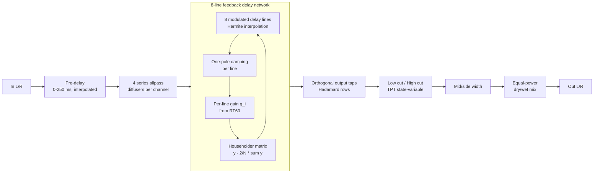
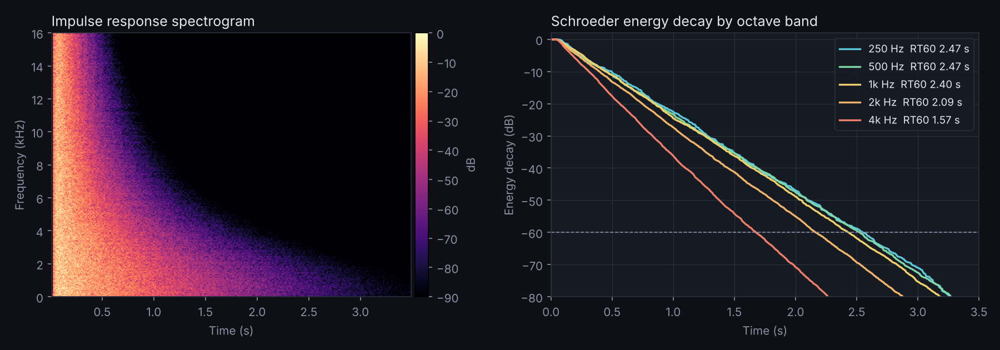

# Eighth Hall - DSP design notes

This document explains how the reverb works, why it's built that way, and how
it was verified. Everything described here is in
[`Source/dsp/FdnReverb.h`](../Source/dsp/FdnReverb.h) and
[`Source/dsp/BuildingBlocks.h`](../Source/dsp/BuildingBlocks.h), written from
scratch in standard C++20 with no JUCE dependency.

## Goals

1. **A smooth, dense, non-metallic tail** across the full range from small rooms to 20 s washes.
2. **Controls that mean what they say.** "Decay 2.5 s" should *measure* as 2.5 s.
3. **Identical sound at every sample rate** from 44.1 kHz to 192 kHz.
4. **Production-safe real-time code:** no allocation, locks, or I/O on the audio thread; click-free automation; no denormal slowdowns.
5. **Cheap enough to use on every channel** (target: < 2% of one core per instance).

## Signal flow

## Design decisions

### Why a feedback delay network?
The classic Schroeder/Moorer designs (and Freeverb, which JUCE's built-in
`juce::Reverb` is based on) use parallel comb filters. They're cheap, but each
comb rings at its own set of pitches, which you hear as metallic coloration on
drums and plucks. An FDN (Jot & Chaigne, 1991) cross-feeds all its delay lines
through a mixing matrix, so echo density grows exponentially over time and no
single line's resonance dominates.

### Exact decay control
The feedback matrix is **orthogonal** (energy-preserving), so the only energy
loss in the loop is the per-line gain. Choosing

    g_i = 10^(-3 * d_i / (RT60 * fs))

makes every path lose exactly 60 dB in RT60 seconds, whatever its length
`d_i`. Because `d_i` is recomputed from the *current* (size-scaled, modulated)
delay, decay stays correct while Size is moving.

### Householder instead of Hadamard feedback
Both are orthogonal. The Householder reflection `A = I - (2/N) 11ᵀ` costs O(N)
(one sum, one subtract per line) versus O(N log N) for a fast Hadamard
transform, and mixes every line into every other line in a single pass.
Hadamard rows are still used for the *output taps*, where their mutual
orthogonality gives decorrelated left/right outputs from a mono source
(measured L/R correlation ≈ -0.05).

### Delay lengths
Eight lengths from 29.7 ms to 79.3 ms, chosen to share no common factors so
echoes never pile up at regular intervals (which would be heard as pitch or
flutter). Size scales them all together, 0.25x-1.75x, on a squared curve for
finer control of small rooms.

### Modulation
Each line's read position is swept by its own sine LFO (phases spread evenly,
rates spread ±15% around the Rate control), up to ±0.65 ms. Constantly moving
delay times prevent the tail from settling into stable resonant modes, the
standard cure for "ringing" in long digital reverbs. Reading at fractional
positions uses **4-point cubic Hermite interpolation**, which has much lower
high-frequency loss and noise than linear interpolation.

### Damping
A one-pole low-pass inside each line makes high frequencies lose more energy per
trip than lows, as air and soft surfaces do in real rooms. Its DC gain is
exactly 1, so the Decay setting stays accurate at low/mid frequencies while
highs fall faster (see the octave-band measurements below). The editor's graph
computes the resulting 8 kHz RT60 analytically from the filter's magnitude
response and the average loop length.

### Freeze
Freeze crossfades every line gain to 1.0 and every damping filter to
pass-through over 100 ms, and mutes new input. Because the matrix is lossless,
the tail then sustains indefinitely (measured: -1.9 dB over 8 s, the small loss
coming from interpolation).

### Real-time engineering
- **Allocation only in `prepare()`**: delay buffers are sized for the largest
  Size + modulation at the current sample rate.
- **Power-of-two ring buffers**: index wrap is a bit-mask, no branches or modulo.
- **Control-rate updates**: coefficients (including the `pow`, `exp`, `tan`
  calls) are recomputed every 16 samples (0.33 ms at 48 kHz), not every sample.
- **Smoothing**: Mix, Width, Pre-delay, Size and Freeze glide to new values, so
  automation never clicks.
- **Lock-free parameter access**: the audio thread reads parameters through
  `std::atomic<float>`; meters pass peaks back the same way.
- **Denormal protection**: `juce::ScopedNoDenormals` sets flush-to-zero on x86 and ARM.
- **State-variable filters** (Zavalishin's TPT form) for Low/High Cut stay
  stable under fast cutoff modulation, unlike direct-form biquads.

## Verification

`tests/ReverbTests.cpp` treats the engine like hardware on a QA bench. All tests
run automatically on Windows, macOS and Linux on every commit.

| Test | Method | Result |
|---|---|---|
| Decay accuracy | Impulse response → Schroeder backward integration → T30 fit in the 1 kHz octave band (ISO 3382 style) | Within 0.6-2.1% for 0.5, 1, 2.5, 6 s |
| Sample-rate independence | Same measurement at 44.1 / 48 / 88.2 / 96 / 192 kHz | 1.98-1.99 s for a 2.0 s setting |
| Stability | 200 runs, random settings incl. freeze, loud noise, random block sizes, mid-stream parameter changes | No NaN/Inf, bounded output |
| Transparency | Mix = 0% vs. input | Bit-identical (error < 1e-6) |
| Freeze | RMS 1-2 s vs 8-9 s after engaging | -1.9 dB; decays normally after release |
| Stereo | L/R correlation of tail from mono impulse; Width = 0% | -0.05; exact mono |
| CPU | 20 s stereo @ 48 kHz, 512-sample blocks | ~110x real time (< 1% of one core) |

The plugin also passes **[pluginval](https://github.com/Tracktion/pluginval)
at strictness level 10** (includes Steinberg's VST3 validator, parameter fuzzing,
state save/restore, and thread-safety tests), plus Apple's `auval` for the
Audio Unit.

*Hall setting (Decay 2.5 s, Damping 8 kHz): straight-line energy decay in every
octave band (a clean exponential tail with no early "double slope"), with highs
decaying progressively faster than lows.*

## Browser port

`website/eighth-hall/reverb-engine.js` is a line-for-line JavaScript port of the
engine that runs in an AudioWorklet (with a ScriptProcessor fallback for pages
served over plain HTTP). Rendering the same impulse response through both
versions gives a correlation of 1.000 and a difference of about 0.02%,
explained by float vs. double rounding. It runs roughly 60x faster than real time in Node.js.

## Possible next steps

- Per-line **shelving absorption filters** (Jot's method) for independent low/high decay times.
- A separate **early-reflections** stage driven by room geometry.
- **SIMD**: the 8 lines map naturally onto two SSE/NEON registers (or one AVX register).
- Tempo-synced pre-delay, ducking (sidechain the wet signal against the dry), and user preset saving.

## References

- M. R. Schroeder, "Natural Sounding Artificial Reverberation," *JAES*, 1962.
- J.-M. Jot and A. Chaigne, "Digital Delay Networks for Designing Artificial Reverberators," AES Convention, 1991.
- V. Välimäki, J. Parker, L. Savioja, J. O. Smith, J. Abel, "Fifty Years of Artificial Reverberation," *IEEE TASLP*, 2012.
- V. Zavalishin, *The Art of VA Filter Design*, Native Instruments, 2012/2018.
- ISO 3382-1, Measurement of room acoustic parameters.
